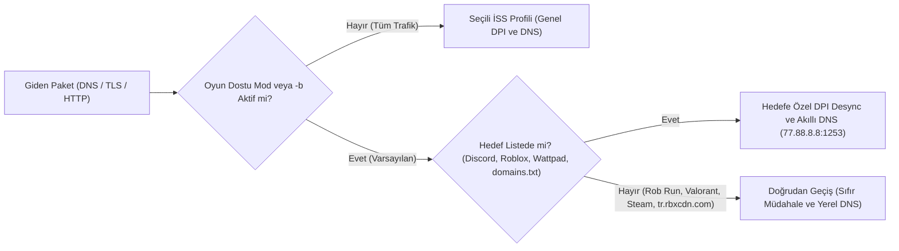

<div align="center">

# GoodbyeDPI-Turkey (TurkDPI v2.1)

**Discord (Web, Masaüstü ve Ses/WebRTC), Roblox ve engelli servisler için saf C99, Sistem Tepsili, Oyun Dostu yüksek hızlı DPI atlatma motoru**

[](https://github.com/SS2Genji/GoodbyeDPI-Turkey/actions/workflows/build.yml)
[](https://github.com/SS2Genji/GoodbyeDPI-Turkey/releases)
[](https://github.com/SS2Genji/GoodbyeDPI-Turkey/releases)
[](#)
[](LICENSE)

[Hızlı Kurulum](#kurulum) · [Oyun Dostu Mod](#oyun-dostu) · [Sistem Tepsisi](#tepsi) · [Türkiye İSS Profilleri](#profiller) · [Mimari & Benchmark](#benchmark) · [Derleme](#derleme) · [Sorun Giderme](#sss)

</div>

---

## Özet ve Öne Çıkan Özellikler

Bu proje, [GoodbyeDPI](https://github.com/ValdikSS/GoodbyeDPI) ve [GoodbyeDPI-Turkey](https://github.com/cagritaskn/GoodbyeDPI-Turkey) yaklaşımlarını temel alarak **C99 + WinDivert** ile sıfırdan yeniden tasarlanmış yeni nesil DPI atlatma motorudur. Bir VPN değildir; trafiği uzak bir sunucuya yönlendirmez, bant genişliğini düşürmez ve tek başına yalnızca **3 dosya** (`goodbyedpi.exe`, `WinDivert.dll`, `WinDivert64.sys`) ile doğrudan **Windows Sistem Tepsisinde (System Tray)** çalışır.

| Özellik | Açıklama |
| :--- | :--- |
| **Oyun Dostu Hedefli Mod (Varsayılan)** | DPI bölme, sahte paket ve DNS yönlendirmesini yalnızca engelli alan adlarına (**Discord**, **Roblox**, **Wattpad** + isteğe bağlı `domains.txt`) uygular. **Rob Run (`kefir.games`)**, **Valorant**, **Steam**, bankalar ve normal siteler sıfır müdahaleyle çalışır. |
| **Akıllı DNS QNAME Ayrıştırıcı** | Sıfır bellek tahsisli RFC 1035 sorgu ayrıştırıcısı, UDP 53 yönlendirmesini ve IPv6 `fe80::` yerel DNS sızıntı korumasını yalnızca hedeflenen alan adları için devreye alır; diğer tüm DNS sorguları yerel DNS'iniz üzerinden gider. |
| **Roblox CDN (`rbxcdn.com`) İstisnası** | `roblox.com` ailesi engelli listede yer alırken görsel/varlık CDN'i `rbxcdn.com` kasıtlı olarak hariç tutulur; böylece oyun kapak görselleri (`tr.rbxcdn.com`) yerel İSS Akamai CDN üzerinden eksiksiz yüklenir. |
| **Sıkılaştırılmış Discord Ses / WebRTC Motoru** | UDP ses/görüntü atlatma yalnızca gerçek **Discord IP Discovery**, **RFC 5389 STUN** ve **WebRTC DTLS** imzalarını hedefler; yüksek portlardaki çevrimiçi oyun UDP trafiğine sahte paket enjekte etmez. |
| **Saf Win32 Sistem Tepsisi** | `.cmd` betik karmaşası ve açık siyah `cmd.exe` penceresi yoktur. Dahili UAC manifesti ile yönetici izni alır; tek tıkla **İSS Auto-Probe**, canlı **TLS 1.3 test**, profil geçişi ve **Windows Başlangıç Görevi** sunar. |
| **Donanım Hızlandırmalı Çekirdek** | `SSE4.2 CRC32C`, `SSE2` SIMD arama, $O(1)$ RFC 1624 diferansiyel checksum, toplu `WinDivertRecvEx`/`WinDivertSendEx` (64 paket/döngü) ve sıfır `malloc` conntrack tabloları kullanır. |

---

<a id="kurulum"></a>
## Hızlı Kurulum

1. [Releases](https://github.com/SS2Genji/GoodbyeDPI-Turkey/releases) sayfasından güncel **`GoodbyeDPI-Turkey-Optimized.zip`** arşivini indirin.
2. Arşivi kalıcı bir klasöre çıkarın (örneğin `C:\GoodbyeDPI\`).
3. **`goodbyedpi.exe`** dosyasına çift tıklayın ve UAC yönetici onayını verin.
4. Uygulama doğrudan sağ alt köşedeki **Sistem Tepsisine** yerleşir. İlk çalıştırmada İSS'niz için en hızlı çalışan profili otomatik test ederek seçer ve ayarlarınızı **`turkdpi.cfg`** dosyasına kaydeder.

> [!NOTE]
> Otomatik başlatma özelliği dosya yolunu Windows Görev Zamanlayıcısına (`TurkDPI_Autostart`) kaydettiği için, programı çıkardığınız klasörü sonradan taşımamanız önerilir.

> [!CAUTION]
> **Kaspersky Antivirüs Uyumsuzluğu:** Kaspersky yazılımı (devre dışı bırakılmış, istisna eklenmiş veya yalnızca sistemde kurulu kalmış olsa bile) WinDivert sürücü paketlerini kesebilmektedir. GoodbyeDPI çalışmıyorsa ve sisteminizde Kaspersky varsa tamamen kaldırmanız gerekir; Windows Defender veya alternatif yazılımlarda ise yalnızca uygulama klasörünü dışlamaya eklemeniz yeterlidir.

---

<a id="oyun-dostu"></a>
## Oyun Dostu Mod (Varsayılan) ve `domains.txt`

Eski sürümlerde DPI bölme ve genel UDP 53 DNS yönlendirmesi bilgisayardaki **tüm** bağlantılara uygulandığı için bazı çevrimiçi oyunların sunucu korumaları (`Rob Run / kefir.games` vb.) paketleri düşürebiliyor ve `77.88.8.8:1253` üzerinden çözülmeyen CDN adresleri (`tr.rbxcdn.com`) eksik kalabiliyordu.

**TurkDPI v2.1**, profiller `[0]`–`[6]` arasındayken trafiği alan adı bazında ayırır:



### Dahili Hedef Listesi
Varsayılan liste aşağıdaki hizmetleri ve tüm alt alan adlarını kapsar:
- **Discord:** `discord.com`, `discord.gg`, `discordapp.com`, `discordapp.net`, `discord.media`, `discordcdn.com`, `discordstatus.com`, `dis.gd`, `discord.co`, `discord.new`, `discord.gift`, `discord.design`, `discord.dev`, `discord.tools`, `discord-activities.com`, `discordsays.com`, `discordpartygames.com`
- **Roblox:** `roblox.com`, `rbx.com`, `robloxlabs.com`, `rbxtrk.com`, `rbxinfra.net`, `rblx.co` *(görsel CDN `rbxcdn.com` hariç)*
- **Wattpad:** `wattpad.com`, `w.tt`

### Kendi Alan Adlarınızı Ekleme (`domains.txt`)
Ekstra bir siteyi veya uygulamayı da DPI/DNS filtresinden geçirmek isterseniz:
1. `goodbyedpi.exe` ile aynı klasörde **`domains.txt`** adlı bir metin dosyası oluşturun.
2. Her satıra bir kök alan adı yazın (alt alan adları otomatik kapsanır; `#` ile yorum satırı ve UTF-8 BOM desteklenir):
   ```text
   # Özel erişim kurallarım
   ornek-site.com
   alt.baska-alanadi.org
   ```
3. Sağ alt tepsi menüsünden **DPI Filtresini Duraklat** -> **Başlat** yapın; liste çalışan iş parçacığına güvenli biçimde yeniden yüklenir.

---

<a id="tepsi"></a>
## Sistem Tepsisi (Sağ Tık Menüsü) ve Kaldırma

Sağ alt tepsideki TurkDPI simgesine sağ tıkladığınızda (veya sol tıkladığınızda) aşağıdaki kontroller açılır:

| Menü Öğesi | İşlev |
| :--- | :--- |
| **`⚡ Otomatik İSS Algıla`** | `[0]`–`[6]` profillerini canlı `discord.com` ve `gateway.discord.gg` TLS 1.3 + `www.google.com` kontrolüyle test ederek en hızlı çalışan profili seçer. |
| **`🔍 Discord & TLS 1.3 Bağlantısını Test Et`** | Mevcut aktif profille `discord.com:443` el sıkışma süresini (`ms`) canlı ölçüp bildirim gösterir. |
| **`[0]` – `[7]` Profil Seçimi** | Yeniden başlatma olmadan profiller arasında anında geçiş yapar ve Windows DNS önbelleğini temizler. |
| **`🎮 Oyun Dostu Mod (...)`** | **Oyun Dostu (Sadece Engelli Siteler + `domains.txt`)** ile **Tüm İnternet Trafiği** modları arasında anında geçiş yapar (`turkdpi.cfg` içine kaydedilir). |
| **`⏸ / ▶ DPI Filtresini Duraklat / Başlat`** | WinDivert filtresini geçici olarak durdurur veya `domains.txt` değişikliklerini okuyarak yeniden başlatır. |
| **`🚀 Windows Açılışında Otomatik Başlat`** | Görev Zamanlayıcı üzerinde en yüksek yetkiyle `TurkDPI_Autostart` görevini açıp kapatır. |
| **`🧹 Sürücü ve Ayarları Sıfırla (Tamamen Kaldır)`** | Filtreyi durdurur, `WinDivert` / eski `GoodbyeDPI` servislerini, `TurkDPI_Autostart` görevini ve `turkdpi.cfg` dosyasını siler, DNS önbelleğini temizleyip kapanır. |

Komut satırından temizlemek için yönetici terminalinde `goodbyedpi.exe --remove` komutunu da çalıştırabilirsiniz.

---

<a id="profiller"></a>
## Dahili Türkiye İSS Profilleri (`[0]` – `[7]`)

Profiller `src/desync.c` içinde Türkiye'deki başlıca İSS DPI davranışlarına göre önceden tanımlanmıştır:

| # | Profil Adı | Hedef İSS / Ağ | TCP / TLS Desync Stratejisi | DNS Yönlendirmesi | QUIC & UDP Ses | Oto-Tarama |
| :---: | :--- | :--- | :--- | :--- | :---: | :---: |
| **`[0]`** | **Standart Türkiye** | Türk Telekom, TurkNet, Kablonet, Millenicom, Netspeed | 3-parça SNI-MidSplit (ters sıra, `2B`) + `BadSum` + `BadSeq` | Yandex `77.88.8.8:1253` | Açık | Evet |
| **`[1]`** | **Superonline & Vodafone Modern** | Turkcell Superonline, Vodafone Ev İnterneti | 3-parça SNI-MidSplit (ters sıra, `2B`) + `MD5Sig` + `Auto-TTL` + `BadSeq` | Yandex `77.88.8.8:1253` | Açık | Evet |
| **`[2]`** | **Superonline Alternatif 1** | Superonline Fiber / VDSL | 3-parça SNI-MidSplit (ters sıra, `2B`) + `Auto-TTL` + `BadSeq` | Yandex `77.88.8.8:1253` | Açık | Evet |
| **`[3]`** | **Superonline Alternatif 2** | Superonline (4+ hop uzaktaki santraller) | 3-parça SNI-MidSplit (ters sıra, `2B`) + `Sabit TTL 4` + `BadSeq` | Yandex `77.88.8.8:1253` | Açık | Evet |
| **`[4]`** | **Superonline Alternatif 3 (Klasik)** | Superonline Klasik Mod | 3-parça SNI-MidSplit (`40B`, ters sıra) + `Sabit TTL 3` | Yandex `77.88.8.8:1253` | Açık | Evet |
| **`[5]`** | **ByeDPI Saf SNI-Disorder** | Hafif DPI kullanan tüm İSS'ler *(sahte paketsiz)* | 3-parça SNI-MidSplit (ters sıra, `2B`) — sahte paket yok | Yandex `77.88.8.8:1253` | Açık | Evet |
| **`[6]`** | **Cloudflare DNS + Hibrit** | Port `1253` engelli yurt / kampüs / kurumsal ağlar | 3-parça SNI-MidSplit (ters sıra, `2B`) + `BadSum` + `BadSeq` + `MD5Sig` | Cloudflare `1.1.1.1:53` | Açık | Evet |
| **`[7]`** | **Türk Telekom Alternatif (League / Vanguard)** | Türk Telekom Güvenli İnternet & Riot / Vanguard | `1-Bayt` TLS bölme (sıralı) + `Sabit TTL 3` | Kapalı | Kapalı | Hayır (Manuel) |

### Profil `[7]` — Türk Telekom Alternatif (League / Vanguard ve Güvenli İnternet Uyumluluğu)

Sistem tepsisinden manuel seçilebilen **`[7] Türk Telekom Alternatif (1 Bayt TLS + Sabit TTL 3)`** profili, TLS `ClientHello` paketini yalnızca 1. bayttan böler ve yalnızca TTL değeri `3` olan bir sahte TCP paketi yollar; DNS yönlendirmesi, QUIC bloklama, TCP `MD5Sig`/`BadSeq`/`BadSum` ve UDP ses sahte paketleri bu profilde kapalıdır.

- Riot/Vanguard ve Güvenli İnternet uyumluluğu genel bağlantılara uygulandığından, menüden **`[7]`** seçildiğinde uygulama otomatik olarak **Tüm İnternet Trafiği** moduna geçer (`[0]`–`[6]` profillerine geri döndüğünüzde yeniden **Oyun Dostu Mod** aktif olur).
- Sabit düşük TTL (`3`) ağ yoluna göre değişkenlik gösterebileceği ve otomatik tarayıcı Vanguard bağlantısını test etmediği için otomatik taramaya dahil edilmez. İlk kullanımda League/Vanguard girişi ile Discord masaüstü sesli sohbetini kendi bağlantınızda ayrıca doğrulamanız önerilir.

---

<a id="benchmark"></a>
## Mimari ve Performans Karşılaştırması

Orijinal `GoodbyeDPI-Turkey` kod tabanındaki bellek tahsisi ve doğrusal tarama darboğazları bu motorda C99 ile yeniden yazılmıştır:

- **Sıfır Bellek Tahsisli (`Zero-Allocation`) Conntrack:** DNS yönlendirme ve TCP `SYN-ACK` Auto-TTL takibi için `uthash` + `malloc`/`free` kaldırılmış, yerine 64-bayt önbellek hizalı statik tablolar ve donanımsal `SSE4.2 CRC32C` (`_mm_crc32_u64`) özetleme getirilmiştir.
- **Doğrudan TLS 1.3 & PQ (`X25519MLKEM768`) SNI Tarayıcı (`extract_sni_info`):** `ClientHello` paketini bayt bayt aramak yerine TLS kayıt ve uzantı uzunluklarını atlayarak doğrudan `0x0000` (SNI) uzantısının ofsetini $O(\text{uzantı})$ sürede bulur.
- **Sıfır Tahsisli RFC 1035 DNS QNAME Ayrıştırıcı (`dns_extract_qname`):** Sıkıştırma işaretçilerini ve hatalı etiket uzunluklarını reddederek sorgulanan alan adını dinamik bellek ayırmadan çıkarır ve statik açık adreslemeli alan adı tablosunda doğrular.
- **RFC 1624 Diferansiyel Checksum:** TCP penceresi, sıra numarası, TTL veya yönlendirilmiş DNS IP/port bilgisi değiştirildiğinde paketin tamamını tekrar hesaplamak yerine yalnızca değişen 16/32-bit alanları $O(1)$ sürede günceller.
- **Toplu Çekirdek I/O (`WinDivertRecvEx` / `WinDivertSendEx`):** 64 pakete kadar toplu okuma/yazma ve tek sistem çağrısıyla 3 parçalı ters sıralı SNI gönderimi yapar.

### A/B Çekirdek Benchmark Sonuçları (`make -C src test OPTIMIZE=1`)

`gcc -std=gnu99 -O3 -flto -march=x86-64-v2 -fno-plt` ile Linux test koşusunda (`tests/bench_hotpath.c`) elde edilen değerler:

| Çekirdek / Paket Hattı Aşaması | Orijinal Yaklaşım | TurkDPI v2.1 | Hızlanma |
| :--- | :---: | :---: | :---: |
| **TLS 1.3 PQ-ClientHello SNI** (`1297 B`) | `587.84 ns` | **`7.87 ns`** | **74.7x** |
| **Paket Başlığı Checksum Güncelleme** (`547 B`) | `42.90 ns` | **`2.13 ns`** | **20.2x** |
| **HTTP Başlık Arama (`fast_memmem`)** (`507 B`) | `115.34 ns` | **`22.53 ns`** | **5.1x** |
| **DNS Conntrack (`Giden + Gelen`, 0-Tahsis)** | `80.62 ns` | **`20.28 ns`** | **4.0x** |
| **Uçtan Uca TLS Desync Hattı** | `838.61 ns` | **`184.84 ns`** | **4.5x** |
| **Tek Çekirdek Maks. TLS Desync Hızı** | `1.19 Mpps` | **`5.41 Mpps`** | **4.5x** |
| **Zero-Copy Hedef Alan Adı Arama** | — | **`14.32 ns/op`** | — |

<details>
<summary><strong>Canlı Windows Ölçüm Komutu (PowerShell)</strong></summary>

`goodbyedpi.exe` sistem tepsisinde aktifken anlık RAM/CPU kullanımını ve canlı `discord.com:443` TLS 1.3 el sıkışma gecikmesini PowerShell üzerinden ölçmek için:

```powershell
# Anlık RAM (MB) ve CPU süresini göster
Get-Process goodbyedpi | Select-Object Name, Id, @{N="RAM (MB)";E={[math]::Round($_.WorkingSet64 / 1MB, 2)}}, @{N="CPU (sn)";E={[math]::Round($_.CPU, 3)}}

# Discord.com:443 üzerinde 5 canlı TLS 1.3 el sıkışmasını ölç
$ip = (Resolve-DnsName discord.com -Server 77.88.8.8 -Type A | Select-Object -First 1).IPAddress
1..5 | ForEach-Object {
    $sw = [System.Diagnostics.Stopwatch]::StartNew()
    $tcp = New-Object System.Net.Sockets.TcpClient($ip, 443)
    $ssl = New-Object System.Net.Security.SslStream($tcp.GetStream(), $false)
    $ssl.AuthenticateAsClient("discord.com")
    $sw.Stop()
    Write-Host ("Test #{0}: Protokol={1} | Sure={2} ms" -f $_, $ssl.SslProtocol, $sw.ElapsedMilliseconds)
    $ssl.Dispose(); $tcp.Dispose()
}
```

</details>

<details>
<summary><strong>Gelişmiş Komut Satırı (CLI) Seçenekleri</strong></summary>

Uygulama varsayılan olarak arayüzsüz Sistem Tepsisi modunda açılır, ancak gelişmiş kullanım ve betikler için tüm klasik ve yeni CLI bayraklarını da destekler:

- **Tepsi / Yönetim:** `--auto` (`-A`), `--profile <0..7>` (`-P <0..7>`), `--remove` (`-R`)
- **Modern Strateji:** `--split-sni`, `--md5sig`, `--udp-fake`, `--auto-ttl`, `--set-ttl <N>`, `--min-ttl <N>`, `--wrong-chksum`, `--wrong-seq`, `--native-frag`, `--reverse-frag`, `--max-payload [N]`
- **DNS & Liste:** `--blacklist <dosya>` (`-b`), `--dns-addr <IP>` (`-d`), `--dns-port <port>` (`-g`), `--dnsv6-addr <IPv6>`, `--dnsv6-port <port>`
- **Geleneksel Ön Ayarlar:** `-1` .. `-9` ve sahte paket yükleme (`--fake-from-hex`, `--fake-with-sni`)

</details>

---

<a id="derleme"></a>
## Kaynak Koddan Derleme, Testler ve Depo Yapısı

```text
GoodbyeDPI-Turkey/
├── src/
│   ├── main.c              # WinDivert döngüsü, akıllı QNAME/SNI filtreleme ve Win32 Sistem Tepsisi
│   ├── conntrack.c         # RFC 1035 DNS QNAME ayrıştırıcı, DNS/TCP conntrack, varsayılan liste + domains.txt
│   ├── desync.c            # [0]-[7] İSS profilleri, 3-parça SNI-MidSplit, sahte TCP/UDP göndericisi
│   ├── probe.c             # Dahili non-blocking TLS 1.3 / DNS İSS otomatik algılama motoru
│   ├── turkdpi.h           # Paylaşılan sabitler, SIMD/CRC32C/SNI/checksum inline çekirdekleri
│   └── Makefile            # MinGW-w64 üretim derlemesi + Linux/WSL sanitizer test hedefleri
├── tests/
│   ├── bench_hotpath.c     # Doğruluk, regresyon, ASan/UBSan ve A/B performans test paketi
│   └── shim/               # Linux üzerinde Win32/WinDivert birim testi için hafif başlık taklitleri
├── windows/                # GitHub Actions tarafından derlenip paketlenen hazır x64 Windows çıktıları
└── .github/workflows/      # Otomatik test, MinGW x64 derleme ve Release yayınlama hattı
```

### Birim Testlerini Çalıştırma (Linux / WSL)
```bash
# AddressSanitizer + UndefinedBehaviorSanitizer ile tüm doğruluk ve regresyon testleri
make -C src test SANITIZE=1

# Tam optimizasyon (-O3 -flto -march=x86-64-v2) ile A/B mikro-benchmark paketi
make -C src test OPTIMIZE=1
```

### Windows x64 Binary Çapraz Derleme (MinGW-w64 + WinDivert 2.2.2-A)
```bash
cd src
make CPREFIX=x86_64-w64-mingw32- BIT64=1 OPTIMIZE=1 \
     WINDIVERTHEADERS=../WinDivert-2.2.2-A/include \
     WINDIVERTLIBS=../WinDivert-2.2.2-A/x64 -j4
```

---

<a id="sss"></a>
## Güvenlik, Virüs Taraması ve Sık Karşılaşılan Sorunlar

<details>
<summary><strong>1. Antivirüs uyarısı / VirusTotal sonuçları ve WinDivert içindeki Bitcoin adresi nedir?</strong></summary>

- Tüm kaynak kod `src/` altında açıktır; GitHub Actions (`build.yml`) doğrudan bu kaynak kodu derleyip yayınlar.
- `WinDivert.dll` ve `WinDivert64.sys`, [basil00/WinDivert](https://github.com/basil00/WinDivert) projesinin Microsoft tarafından dijital imzalı açık kaynaklı çekirdek paket yakalama sürücüsüdür. Ağ yığınına doğrudan müdahale eden her sürücü gibi bazı antivirüslerde *false positive* (yanlış pozitif) oluşturabilir; uygulama klasörünü dışlamalara eklemeniz yeterlidir (Kaspersky hariç).
- `.dll`/`.sys` dosya özelliklerindeki Bitcoin adresi kötü amaçlı yazılım veya mining değildir; WinDivert geliştiricisi basil00'ın [resmi bağış sayfasındaki](https://reqrypt.org/donate.html) adresidir.

</details>

<details>
<summary><strong>2. Bir oyun (Rob Run, Valorant vb.) bağlanamıyor veya Roblox kapak resimleri yüklenmiyorsa ne yapmalıyım?</strong></summary>

- Sağ alt tepsi menüsünde **`🎮 Oyun Dostu Mod`** seçili olduğundan emin olun (Profil `[7]` seçildiyse otomatik tüm trafiğe geçer; `[0]`–`[6]` profillerine dönünce tekrar aktifleşir).
- Eğer Türk Telekom Güvenli İnternet aktifken **Valorant / League of Legends** erişim sorunu yaşıyorsanız manuel olarak **`[7] Türk Telekom Alternatif`** profilini seçin.
- Yakın zamanda ayar değiştirdiyseniz menüden **Duraklat -> Başlat** yaparak Windows DNS önbelleğinin yenilenmesini sağlayın.

</details>

<details>
<summary><strong>3. Discord web'de açılıyor ama masaüstü uygulamasında "Update failed" veriyor veya açılmıyorsa</strong></summary>

- Sistemde önceden kalmış başka bir GoodbyeDPI / Zapret / WinDivert servisi çakışıyor olabilir.
- Tepsi menüsünden **Sürücü ve Ayarları Sıfırla (Tamamen Kaldır)** seçeneğini çalıştırıp bilgisayarı yeniden başlatın; ardından yalnızca tek bir klasördeki güncel `goodbyedpi.exe` uygulamasını başlatın.

</details>

<details>
<summary><strong>4. Superonline veya katı DPI ağlarda sayfalar/bağlantı takılıyorsa</strong></summary>

- Sağ tık menüsünden **`⚡ Otomatik İSS Algıla`** seçeneğini çalıştırın veya manuel olarak **`[1] Superonline & Vodafone Modern`**, **`[5] ByeDPI Saf SNI-Disorder`** ya da **`[2]` / `[3]`** arasında geçiş yapın.
- Okul/yurt gibi port `1253` engelli ağlarda **`[6] Cloudflare DNS + Hibrit`** profilini seçin.

</details>

<details>
<summary><strong>5. Ethernet kartıyla hiçbir profil çalışmıyorsa</strong></summary>

- Bazı ağ kartlarının donanımsal checksum offload ayarları paket manipülasyonunu engelleyebiliyor. **harmanprecious** tarafından hazırlanan rehbere [Technopat Sosyal konusundan](https://www.technopat.net/sosyal/konu/goodbyedpi-ethernet-kartiyla-calismiyorsa-ne-yapilmali.3619948/) ulaşabilirsiniz.

</details>

---

## Teşekkür, Lisans ve Yasal Uyarı

- Temel DPI atlatma yaklaşımı için [ValdikSS/GoodbyeDPI](https://github.com/ValdikSS/GoodbyeDPI) ve Türkiye profilleri için [cagritaskn/GoodbyeDPI-Turkey](https://github.com/cagritaskn/GoodbyeDPI-Turkey) projelerine,
- Çekirdek paket sürücüsü için [basil00/WinDivert](https://github.com/basil00/WinDivert) projesine,
- League / Vanguard uyumluluk profili (`#1`) ve test katkıları için [serhataydinxd](https://github.com/SS2Genji/GoodbyeDPI-Turkey/pull/1) başta olmak üzere tüm katkıda bulunanlara teşekkürler.

Bu proje [Apache-2.0 Lisansı](LICENSE) ile lisanslanmıştır.

> [!IMPORTANT]
> Bu uygulamanın kullanımından doğan her türlü hukuki ve teknik sorumluluk kullanıcıya aittir. Yazılım yalnızca eğitim, ağ analizi ve araştırma amaçlarıyla geliştirilmiş ve paylaşılmıştır.
